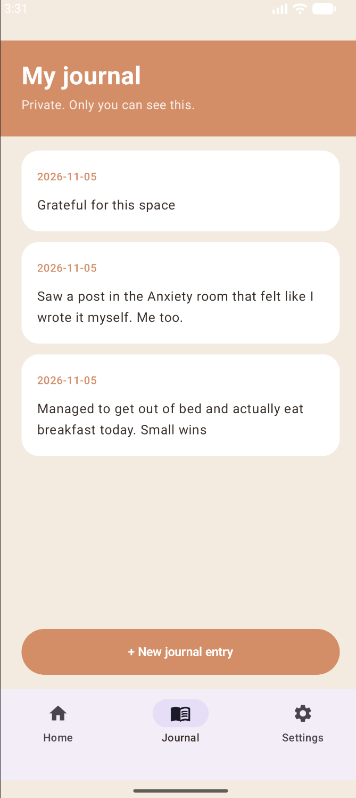

# MIRA - Me, I Relate, Anonymously

**MIRA** is an Android application built in Kotlin that provides a safe, anonymous space for peer support. The app is designed around a simple idea: most people going through something hard assume they are the only one dealing with it, and that is rarely true. By joining topic rooms and using the "Me too" button, users can find comfort in knowing they are not alone. 

This project was developed for the **OPSC6312** POE (Portfolio of Evidence).

## 📱 App Screenshots

| Login Screen | Rooms List | Room Feed |
| :---: | :---: | :---: |
|  |  |  |

| Private Journal | Settings (English) | Settings (isiZulu) |
| :---: | :---: | :---: |
|  |  |  |

 

| Notifications |
| :---: |
|  |

## 📱 App Demonstration Video
Watch the full walkthrough of the app running on a physical Android device below:
*   **YouTube Video:** [https://youtube.com/shorts/xDgwO1Dh3_Q?si=QaV3KlWK4Kl9IQ82]

## ✨ User-Defined Features (For Lecturer Review)
As required by the brief, I have implemented additional features beyond the minimum requirements. Please look out for these when evaluating:
1.  **Private Journal:** A secure, local space where users can log their personal thoughts over time. This data is tied to their account and is completely private (nobody else can see it).
2.  **Offline Mode with Sync:** If a user writes a post without an internet connection, the app saves the draft locally using RoomDB. Once the connection is restored, the app automatically syncs the post to the server and updates its status.
3.  **Multi-Language Support:** The app supports English, isiZulu, and Afrikaans, allowing users to express themselves in the language they think in.

## 🚀 Minimum & Core Features Implemented
*   **Authentication:** Register and login securely with email/password (passwords are securely hashed) and Google Sign-In (SSO).
*   **Anonymous Posting:** Users can post anonymously in topic rooms (e.g., Anxiety, Skin and Acne, Substance Abuse) using randomly generated session aliases.
*   **"Me Too" Interaction:** A core feature allowing users to tap a button to show they relate to a post without having to type a comment.
*   **Topic Rooms:** Dedicated spaces with their own colour themes, ensuring focused discussions. Sensitive rooms include pinned crisis resource banners.
*   **Real-Time Notifications:** Push notifications (via Firebase FCM) alert users when someone taps "Me too" or comments on their post, without revealing identities.
*   **REST API Integration:** The Android app connects to a custom Node.js/Express REST API backed by MongoDB Atlas.

## 🛠️ Built With
*   **Language:** Kotlin
*   **Local Database:** RoomDB (used for offline draft caching and the private journal).
*   **Backend:** Node.js, Express, MongoDB Atlas.
*   **Authentication:** JWT (JSON Web Tokens) for API auth, Google Sign-In for SSO.
*   **CI/CD:** GitHub Actions.

## ⚙️ GitHub Actions & Automated Testing
This repository is integrated with **GitHub Actions** for Continuous Integration. 
*   Every time code is pushed to the `main` branch, a workflow automatically triggers.
*   The workflow runs automated Unit Tests to ensure logic and database functionality is not broken.
*   The workflow builds the Debug APK to verify the code compiles successfully in a clean cloud environment.

## 📲 App Distribution (Firebase)
The built APK has been distributed for testing using Firebase App Distribution.
*   **Invite Link:** https://appdistribution.firebase.dev/i/62fd7e80a03a3853
*   **Release Link:** https://appdistribution.firebase.google.com/testerapps/1:626204447933:android:b90073b0697316fad153d4/releases/07ql8h0cik368

## 💻 How to Run the Project Locally
1. Clone this repository: `git clone https://github.com/Mahlatselucky/MIRA-ANDROID.git`
2. Open the project in **Android Studio**.
3. Allow Gradle to sync and download dependencies.
4. Click **Run** (the green play button) to launch the app on an emulator or connected physical device.

## 📚 References
*   TalkLife. (2026). *TalkLife: Peer Support*.
*   Sober Sidekick. (2026). *Sober Sidekick: Quit Addiction*.
*   Wisdo. (2026). *Wisdo: Mental Health & Support*.
*   Android Developers. (2024). *Room Persistence Library*.
*   GitHub Docs. (2024). *GitHub Actions Documentation*.
*   Firebase. (2024). *App Distribution Documentation*.
